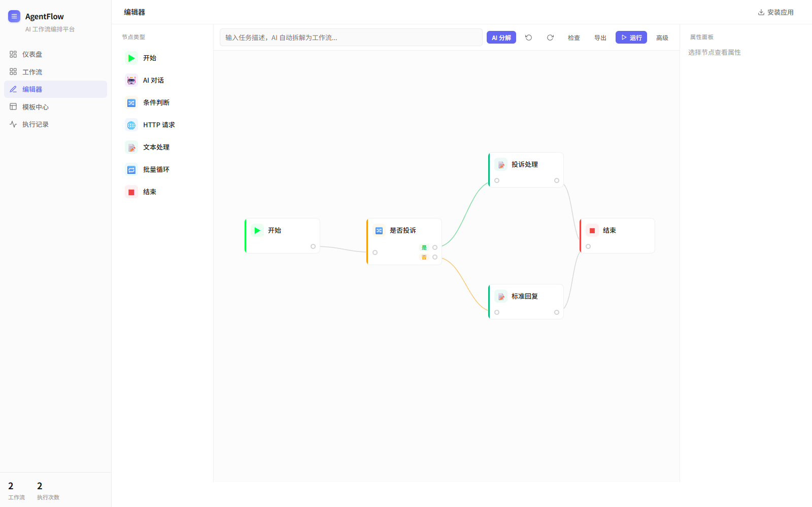
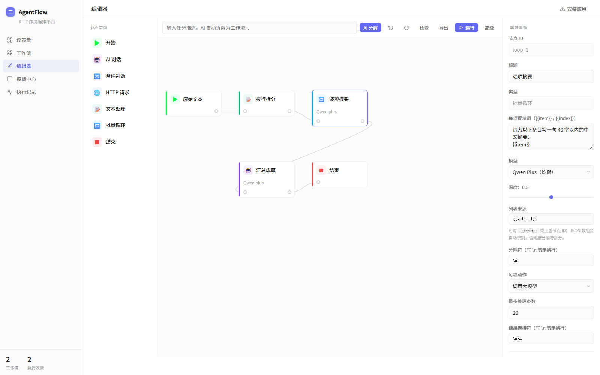
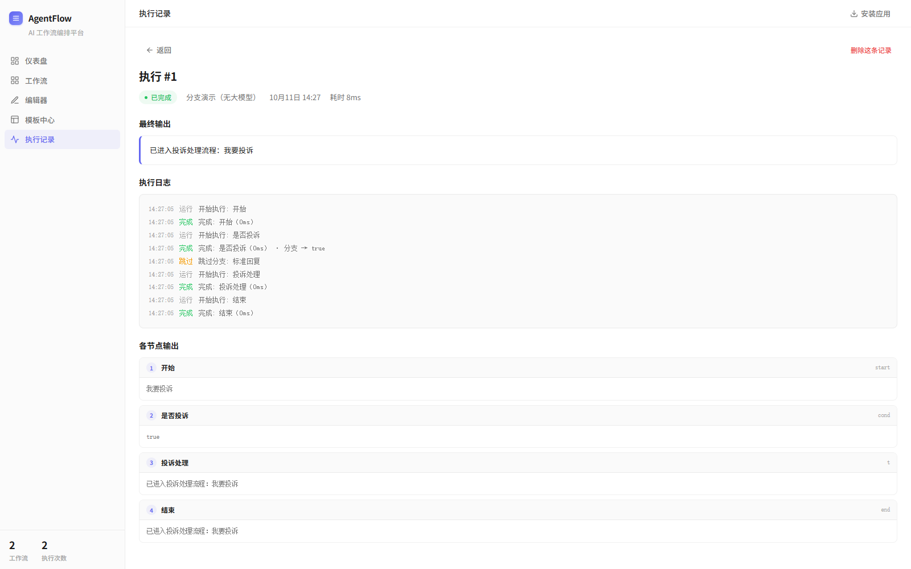

# AgentFlow - AI 工作流编排平台


**可视化 AI 工作流编排平台** — 拖拽节点、连线编排，让 AI 代理自动执行复杂任务

[English](#english) | [中文](#中文)



条件节点的两个出口分别画线，未选中的分支在执行日志里记为「跳过」。

> **在线演示**：<http://47.101.60.110:8001>（阿里云轻量应用服务器，华东2-上海）
> 打开后会先进口令页，访问口令随简历/作品册一并提供，不在仓库里公开。
> 会话 12 小时有效；未登录时 `/api/*` 一律 401，WebSocket 握手被拒。
> 部署有效期到服务器到期日为止，如果链接打不开请直接用本地方式运行。

---

## 🇨🇳 中文

### 📖 项目简介

AgentFlow 是一个基于可视化编排的 AI 工作流平台。用户通过拖拽节点、连线的方式构建自动化工作流，系统支持任务智能分解、多模型调度、条件分支、实时执行监控等功能。

**核心亮点：**
- 可视化工作流编辑器（拖拽 + 连线）
- AI 任务智能分解（复杂任务自动拆分为子任务）
- 多模型调度（qwen-turbo / qwen-plus / qwen-max）
- 条件分支真路由（「是 / 否」双出口，未选中的分支自动跳过）
- 批量循环节点（列表逐项调用大模型，并发执行后聚合）
- WebSocket 实时执行日志（含每个节点耗时与分支结果）
- 运行可随时停止，执行记录可删除，工作流可导入导出为 JSON
- 预设工作流模板

### 🏗️ 系统架构

```
┌─────────────────────────────────────────────────────────────┐
│                      Frontend  Web UI / Electron             │
│  ┌──────────────┐  ┌──────────────┐  ┌──────────────────┐  │
│  │ Node Palette │  │   Canvas     │  │  Properties      │  │
│  │  (Drag)      │─▶│  (SVG Edges) │  │  Panel           │  │
│  └──────────────┘  ──────────────┘  └──────────────────┘  │
└─────────────────────────────────────────────────────────────┘
                              │
                    RESTful API + WebSocket
                              │
┌─────────────────────────────────────────────────────────────┐
│                      Backend (FastAPI)                        │
│  ┌──────────────┐  ┌──────────────┐  ┌──────────────────┐  │
│  │  Workflow    │  │   Execution  │  │    LLM Client    │  │
│  │  Engine      │─▶│   Engine     │─▶│  (Multi-Model)   │  │
│  └──────────────┘  └──────────────┘  └──────────────────┘  │
│                          │                                    │
│                    ┌─────┴─────┐                              │
│                    │  SQLite   │                              │
│                    └───────────┘                              │
─────────────────────────────────────────────────────────────┘
```

### ✨ 功能特性

- **🎨 可视化编辑器** — 拖拽节点、SVG 连线、实时预览、Ctrl+Z 撤销
- **🤖 AI 任务分解** — 输入复杂任务，自动拆分为可执行子任务
- **🔀 条件分支** — 表达式求值（`==` `!=` `>` `>=` `<` `<=` `contains` `and` `or`），结果从「是 / 否」两个端口分流，未选中的分支在执行日志中记为「跳过」；`and` 比 `or` 结合更紧，`x or y and z` 里 x 命中就走「是」，不会被后面的 `and` 拉回去；节点输出都是文本，`score > 50` 会先把文本按数值对齐再比较，求不了值时把原因写进日志而不是静默走 false
- **🔁 批量循环** — 把上游列表（JSON 数组或按分隔符拆分的文本）逐项交给大模型，3 路并发、条数上限可调，结果聚合为一段；哪项失败由执行结果自己标记，不靠输出文本的前缀猜
- **🌐 HTTP 请求** — GET / POST / PUT / PATCH / DELETE，支持自定义请求头与请求体，可配置 4xx/5xx 是否判定为失败
- **📝 文本处理** — 拼接、拆分为列表、查找替换
- **⚡ 多模型调度** — 不同节点使用不同模型（turbo/plus/max）
- **🧩 变量引用** — 节点配置中用 `{{input}}` 引用入口内容，用 `{{节点ID}}` 引用上游输出，循环节点内还可用 `{{item}}` / `{{index}}`；整串文本只扫一遍做替换，所以上游输出里恰好写着 `{{别的节点}}` 时它只是一个字符串，不会被再代入别人的结果
- **✅ 执行前校验** — 缺少开始/结束节点、连线指向幽灵节点、必填配置为空、节点不可达时直接返回中文原因，不会跑出一个半成品结果；节点 ID 只允许字母、数字、下划线和连字符，因为编辑器要把 ID 写进 CSS 选择器和内联事件，导入外部 JSON 时这条规则挡掉了能执行脚本的 ID
- **📊 实时日志** — WebSocket 推送每个节点的起止、耗时与分支走向，连上时先补一份已有的日志与状态，断线自动降级为轮询
- **🛑 运行可停止** — 长耗时的模型或 HTTP 节点可中途取消，取消后写入「已取消」记录并保留已产生的日志；服务重启遗留的 running 行会被自动收敛，意外崩溃同样会写回 error 并通知前端，不会把界面永远卡在「运行中」
- **🗂 执行记录管理** — 单条停止/删除、一键清空已完成，运行中的记录不会被误删
- **📦 导入导出** — 工作流可导出为 JSON 文件（带 `format`/`version`），导入时先做结构校验，缺 id、连线指向幽灵节点都会逐条中文报错
- **💾 自动保存去抖** — 配置面板连续输入合并为一次提交，保存串行排队且按调度时的快照落盘，切换工作流后不会把上一张图写进新打开的那份；保存失败会提示一次，而不是假装已经存好
- **📋 工作流模板** — 预设 8 个模板，含条件分流与批量循环示例
- **🔐 公网访问闸门** — 设了 `AGENTFLOW_ACCESS_CODE` 才生效：口令换 12 小时签名 Cookie，按 IP 限登录/执行/分解/试跑，全站每天还有运行次数上限；没设口令时本地和 Electron 的行为与之前完全一致

**批量循环**：循环节点把上游列表逐项交给模型，配置面板可见列表来源、分隔符、并发上限。



**执行详情**：每个节点的输出、耗时与分支走向按顺序展开。



### 🧱 节点类型

| 节点 | 输入 | 输出 | 关键配置 |
|------|------|------|----------|
| ▶ 开始 | — | output | 工作流入口，接 `input` 变量 |
| 🤖 AI 对话 | input | output | `prompt` `model` `temperature` |
| 🔀 条件判断 | input | true / false | `condition` 表达式 |
| 🔁 批量循环 | input | output | `source` `separator` `action` `prompt` `max_items` `join` |
| 🌐 HTTP 请求 | input | output | `url` `method` `headers` `body` `fail_on_error` |
| 📝 文本处理 | input | output | `operation` `texts` `separator` `old` `new` |
| ⏹ 结束 | input | — | 输出最后一个业务节点的 result |

### 🛠️ 技术栈

| 组件 | 技术 |
|------|------|
| 后端框架 | FastAPI + Uvicorn |
| 数据库 | SQLite + SQLAlchemy |
| 大语言模型 | 阿里云百炼 (qwen-turbo/plus/max) |
| 实时通信 | WebSocket |
| 前端 | 原生 HTML/CSS/JS，无框架依赖 |
| 桌面端 | Electron 打包为 Windows 安装包 |
| 离线 | Service Worker + Web App Manifest |
| 容器化 | Dockerfile（非 root 运行 + 健康检查）+ docker-compose |

### 🚀 快速开始

#### 前置要求

- Python 3.11+
- 阿里云百炼 API Key（[获取地址](https://bailian.console.aliyun.com/)）

#### 本地运行

```bash
# 1. 克隆项目
git clone https://github.com/cappercclove/agentflow.git
cd agentflow

# 2. 创建虚拟环境
python -m venv venv
source venv/bin/activate  # Linux/Mac
# venv\Scripts\activate   # Windows

# 3. 安装依赖
pip install -r backend/requirements.txt

# 4. 配置环境变量
cp backend/.env.example backend/.env
# 编辑 backend/.env，填入你的百炼 API Key

# 5. 启动服务
cd backend
uvicorn main:app --host 0.0.0.0 --port 8000

# 6. 访问
# 前端: http://localhost:8000
# API文档: http://localhost:8000/docs
```

#### Docker 部署

```bash
# 1. 配置环境变量（compose 的 env_file 指向它，文件不存在会直接起不来）
cp backend/.env.example backend/.env
#    填入 BAILIAN_API_KEY 与 BAILIAN_BASE_URL，公网部署再补上口令那几行

# 2. 构建并启动
docker-compose up -d

# 3. 访问 http://localhost:8001
```

#### 公网部署：访问口令与限流

一个挂在公网地址上的 AgentFlow，任何访客都能花掉部署者的模型额度，所以加了闸门。**所有开关都只在设置了口令之后生效**，`git clone` 下来直接跑、或用 Electron 打包时，行为与之前一模一样。

| 环境变量 | 默认 | 说明 |
|------|------|------|
| `AGENTFLOW_ACCESS_CODE` | 空（闸门关闭） | 站点口令。设置后除 `/health`、`/login`、`/api/login` 外都要带会话 Cookie |
| `AGENTFLOW_SESSION_SECRET` | 从口令派生 | Cookie 的 HMAC 密钥；换口令会让所有人重新登录 |
| `AGENTFLOW_TRUST_PROXY` | 关 | 前面有 Nginx/Caddy 时开启，按 `X-Forwarded-For` 记 IP。**不开的话所有访客会被算成同一个 `127.0.0.1`，共用一份额度** |
| `AGENTFLOW_COOKIE_SECURE` | 关 | 站点走 HTTPS 时开启，Cookie 不在明文连接上发送 |
| `AGENTFLOW_LIMIT_LOGIN` | 10 / 10 分钟 | 同一 IP 的口令尝试次数 |
| `AGENTFLOW_LIMIT_EXECUTE` | 30 / 小时 | 同一 IP 启动的运行数 |
| `AGENTFLOW_LIMIT_DECOMPOSE` | 10 / 小时 | 同一 IP 的 AI 任务分解次数 |
| `AGENTFLOW_LIMIT_NODE` | 20 / 小时 | 同一 IP 的单节点试跑次数 |
| `AGENTFLOW_DAILY_RUNS` | 200 / 天 | 全站每天可启动的运行数，校验不通过的请求不计入 |

未授权时：`/api/*` 返回 401（前端收到后会跳到口令页），其余路径 302 到 `/login`，WebSocket 握手直接被拒（403）。口令页是自带样式的单文件页面，不依赖 `frontend/` 里的任何东西——那部分同样在闸门后面。会话有效期 12 小时，Cookie 为 `HttpOnly` + `SameSite=Lax`。

上线前还需要：`BAILIAN_API_KEY` 只从环境变量或 `backend/.env` 注入，不要把填好的 `.env` 提交进仓库（`.dockerignore` 也已经把它挡在镜像之外）；SQLite 落在 `docker-compose.yml` 声明的命名卷 `agentflow-data` 里，容器重建不丢工作流。

#### 上线到一台服务器

以能跑 Docker 的 Linux 主机为例（阿里云轻量应用服务器、学生机都一样）：

```bash
# 1. 控制台放行 8001 端口（轻量应用服务器叫「防火墙」，不在安全组里）
# 2. 装 Docker 后拉代码
git clone https://github.com/cappercclove/agentflow.git && cd agentflow

# 3. 只写这一个文件，别把密钥留在命令行历史里
cp backend/.env.example backend/.env
#    BAILIAN_API_KEY=...           模型密钥
#    AGENTFLOW_ACCESS_CODE=...     站点口令，写了闸门才会开
#    AGENTFLOW_TRUST_PROXY=1       下面配了 Nginx 才需要
#    AGENTFLOW_COOKIE_SECURE=1     上了 HTTPS 才需要

# 4. 起容器（宿主 8001 → 容器 8000，工作流与执行记录落在命名卷 agentflow-data）
#    国内宿主机从默认 PyPI 拉依赖只有几十 kB/s，构建前在项目根目录的 .env 里
#    写一行 PIP_INDEX_URL=https://mirrors.aliyun.com/pypi/simple/ 即可走镜像站
docker compose up -d

# 5. 反代：WebSocket 的 Upgrade 头和 X-Forwarded-For 都得有，仓库里备好了现成的
sudo cp deploy/nginx-agentflow.conf /etc/nginx/conf.d/agentflow.conf
sudo nginx -t && sudo systemctl reload nginx

# 6. 自查三条：健康检查 200、未登录时 302 到口令页、登录后能跑一次
curl -i http://<你的IP>/health
curl -i http://<你的IP>/            # 期望 302 -> /login
```

到这里只有 HTTP，口令和会话 Cookie 是明文过网的。演示场景里这通常够用（口令只保护一份模型额度，且限流已经关掉滥用），但只要有域名就该补上 HTTPS：`sudo certbot --nginx -d <域名>`，证书签发后把 `AGENTFLOW_COOKIE_SECURE=1` 打开并 `docker compose up -d` 重启一次。

> 只想临时给人看一眼、不打算配 Nginx 的话，把 `docker-compose.yml` 的端口映射改成 `"80:8000"` 直接暴露容器即可。这种情况下不要开 `AGENTFLOW_TRUST_PROXY`——没有反代加头，开了反而会把真实 IP 记错。

### 📡 API 文档

启动服务后访问 `http://localhost:8000/docs` 查看交互式 API 文档。

**主要接口：**

| 方法 | 路径 | 说明 |
|------|------|------|
| GET | `/` | 前端页面（设了访问口令且未登录时 302 到 `/login`） |
| GET | `/login` | 口令页，闸门开启时也保持可访问 |
| POST | `/api/login` | 校验口令并签发 12 小时会话 Cookie |
| GET | `/api/node-types` | 获取节点类型定义 |
| POST | `/api/workflows` | 创建工作流 |
| GET | `/api/workflows` | 获取工作流列表 |
| GET | `/api/workflows/{id}` | 获取工作流详情 |
| PUT | `/api/workflows/{id}` | 更新工作流 |
| DELETE | `/api/workflows/{id}` | 删除工作流 |
| POST | `/api/workflows/import` | 从 JSON 文件导入工作流（只做结构校验，允许草稿） |
| POST | `/api/workflows/{id}/execute` | 执行工作流（先做结构校验，不通过返回 400 与中文原因；闸门开启时受每 IP 与每日额度约束，超限 429） |
| POST | `/api/workflows/validate` | 只校验图结构，返回问题列表 |
| POST | `/api/nodes/execute` | 单节点试跑（调试用） |
| POST | `/api/decompose` | AI 任务分解 |
| GET | `/api/executions` | 获取执行记录 |
| POST | `/api/executions/{id}/cancel` | 停止运行中的执行（无主任务直接收敛为已取消） |
| DELETE | `/api/executions/{id}` | 删除单条执行记录（运行中返回 409） |
| DELETE | `/api/executions` | 清空已完成/失败/已取消的执行记录 |
| GET | `/api/stats` | 获取统计信息 |
| WS | `/ws/execute/{id}` | WebSocket 实时日志（连接即收到 `snapshot`，已结束的还会补一帧 `complete`） |

###  项目结构

```
agentflow/
├── backend/
│   ├── main.py                 # FastAPI 入口，REST + WebSocket 路由
│   ├── models.py               # SQLAlchemy 数据模型
│   ├── workflow_engine.py      # 执行引擎（条件求值、循环并发、图校验）
│   ├── llm_client.py           # 多模型 LLM 客户端
│   ├── auth.py                 # 口令会话签名、按 IP 限流、每日额度（不设口令即空转）
│   ├── login_page.py           # 自带样式的口令页
│   ├── node_types.py           # 节点类型定义
│   ├── tests/                  # pytest 用例
│   ├── requirements.txt
│   └── .env.example            # 环境变量模板
├── frontend/
│   ├── index.html              # 单页应用入口
│   ├── css/style.css
│   ├── js/
│   │   ├── app.js              # 视图切换与 API 调用
│   │   ├── editor.js           # 可视化编辑器（拖拽 + SVG 连线）
│   │   └── templates.js        # 内置工作流模板
│   ├── icons/                  # 应用图标
│   ├── manifest.json           # PWA 清单
│   ├── sw.js                   # Service Worker 离线缓存（改动前端资源后需同步 bump CACHE_NAME）
│   └── offline.html            # 离线兜底页
├── electron.js                 # 桌面端主进程（拉起后端 + 创建窗口）
├── package.json                # Electron 打包配置
├── docs/
│   ├── screenshots/            # 界面截图
│   └── sample_workflow.json
├── Dockerfile
├── .dockerignore                # 挡住 backend/.env 与 *.db，不让密钥进镜像层
├── docker-compose.yml
├── deploy/
│   └── nginx-agentflow.conf    # 反代模板：WebSocket Upgrade 头与 X-Forwarded-For
├── LICENSE
└── README.md
```

### 🔮 未来计划

- [ ] 接入独立 Embedding 模型
- [ ] 添加 Redis 缓存层
- [ ] 支持子工作流调用
- [ ] 用户认证与多用户管理
- [ ] 工作流版本控制
- [ ] Nginx 反向代理 + HTTPS

---

## 🇬🇧 English

###  Introduction

AgentFlow is a visual AI workflow orchestration platform. Users build automation workflows by dragging nodes and connecting edges. The system supports intelligent task decomposition, multi-model scheduling, conditional branching, and real-time execution monitoring.

> **Live demo**: <http://47.101.60.110:8001> — hosted on an Alibaba Cloud Simple Application Server (Shanghai). Visitors land on an access-code page first; the code is shared with reviewers rather than committed here. Sessions last 12 hours, unauthenticated `/api/*` calls return 401, and WebSocket handshakes are refused.

### ✨ Features

- **🎨 Visual Editor** — Drag-and-drop nodes, port-anchored SVG edges, undo/redo
- **🤖 AI Task Decomposition** — Automatically split complex tasks into subtasks
- **🔀 Real Branch Routing** — Expressions (`==` `!=` `>` `contains` `and` `or`) pick the 是/否 output port; the untaken branch is logged as skipped instead of executed. `and` binds tighter than `or`, so a rule that reads "x, or y and z" still takes the true branch when x alone matches
- **🔁 Batch Loop** — Feed a list (JSON array or split text) item by item into the model, 3-way concurrent, capped and joined back into one result. Whether an item failed travels with its text instead of being guessed from a prefix, so an answer that happens to start like a failure message is not counted as one
- **🌐 HTTP Requests** — GET / POST / PUT / PATCH / DELETE with headers and body, optional fail-on-4xx/5xx
- **📝 Text Processing** — Concatenate, split into a list, replace
- **🧩 Variable Binding** — `{{input}}` plus any upstream node id, and `{{item}}` / `{{index}}` inside a loop. Substitution is a single pass, so upstream output that happens to contain `{{something}}` stays the text it is rather than picking up another node's value
- **✅ Pre-run Validation** — Missing start/end, dangling edges, empty required config or unreachable nodes are rejected with readable messages. Node ids are limited to `[A-Za-z_][A-Za-z0-9_-]*` because the editor writes them into CSS selectors and inline handlers, so an imported file cannot smuggle in a script-executing id
- **📊 Real-time Logs** — WebSocket stream of per-node start/finish, duration and branch. The socket opens with a snapshot of what already happened, so a run that finishes while the page is still fetching its first copy does not sit at 运行中, and a dropped connection falls back to polling
- **🛑 Cancellable Runs** — Stop a long-running model or HTTP node mid-flight; the run is written as cancelled with the logs it already produced, and rows orphaned by a server restart are reaped
- **🗂 Execution Hygiene** — Cancel or delete a single run, or clear finished ones in bulk, while live runs are protected
- **📦 Import / Export** — Workflows round-trip as versioned JSON; import validates shape and reports each problem in readable Chinese
- **💾 Debounced Autosave** — A burst of keystrokes collapses into one queued PUT that carries the graph it was scheduled for, and a failed save says so once instead of pretending nothing happened
- **📋 Workflow Templates** — 8 pre-built templates including branching and batch-loop examples
- **🔐 Public Deployment Gate** — Inert until `AGENTFLOW_ACCESS_CODE` is set: the code buys a 12-hour signed cookie, per-IP budgets cover login, execute, decompose and single-node runs, and a site-wide daily cap bounds started runs. Unauthenticated API calls get 401, pages redirect to a self-contained `/login` card, and the WebSocket handshake is refused outright

###  Quick Start

```bash
git clone https://github.com/cappercclove/agentflow.git
cd agentflow
python -m venv venv && source venv/bin/activate
pip install -r backend/requirements.txt
cp backend/.env.example backend/.env  # Edit with your API Key
cd backend && uvicorn main:app --host 0.0.0.0 --port 8000
```

Visit `http://localhost:8000` for the web UI.

### ️ Tech Stack

Python · FastAPI · SQLite · WebSocket · Alibaba Cloud Bailian LLM · Electron desktop shell

### 📄 License

[MIT License](LICENSE)

⭐ If you find this project useful, consider giving it a star!
